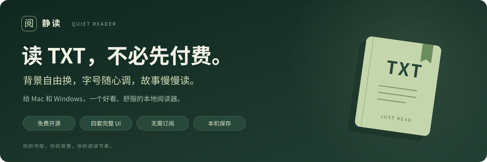
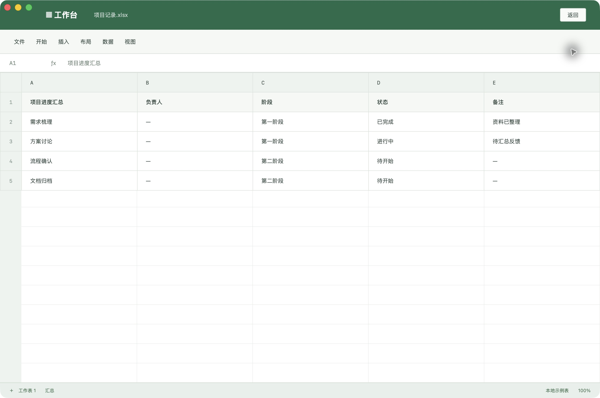

<div align="center">



# 静读 · Quiet Reader

**不想为 TXT 阅读器付费？换个背景也不想再解锁会员？**  
试试静读：免费开源，把阅读界面调成你喜欢的样子。

### [↓ 下载 Mac 版](https://github.com/Aishuomeng/quiet-reader/releases/download/v3.0.0/QuietReader-3.0.0-macOS-arm64-guided.zip)　｜　[↓ 下载 Windows 预览版](https://github.com/Aishuomeng/quiet-reader/releases/download/v3.0.0/QuietReader-3.0.0-Windows-x64.zip)

**[Mac 提示“Apple 无法验证”？点这里开始 →](docs/MAC_FIRST_OPEN.md)**  
[↓ 直接下载设置快捷链接（无需解压）](https://github.com/Aishuomeng/quiet-reader/releases/download/v3.0.0/QuietReader-Open-Settings.webloc) · [下载图文引导（约 3 KB）](https://github.com/Aishuomeng/quiet-reader/releases/download/v3.0.0/QuietReader-Mac-First-Open.zip)

[全部发行文件](https://github.com/Aishuomeng/quiet-reader/releases/tag/v3.0.0) · [使用指南](docs/USER_GUIDE.md) · [构建说明](docs/BUILD.md)

Mac 包适用于 Apple Silicon（M 系列）；Windows 包适用于 10 / 11 x64，尚未实机验证。

</div>


<p align="center"><sub>实际 macOS App 截图 · 二次元版「樱语」 · 下方所有截图均来自真实界面，展示本项目原创示例小说。</sub></p>

## 只想安静读本书，不想先研究付费套餐。

把 TXT 拖进来，选个喜欢的背景，接着上次的位置读。  
**静读当前发行版没有订阅、内购或付费功能解锁，也不需要注册账号。**

| 你想要的 | 静读直接给你 |
| --- | --- |
| 在 Mac 上舒服地读 TXT | 独立桌面 App，支持全屏与专注模式 |
| 换张喜欢的壁纸 | 自选图片，全窗口铺开；缩放、位置、明暗、模糊自由调 |
| 把文字调到刚刚好 | 字号、字体、行距、颜色、正文宽度、面板透明度可调 |
| 少动一下手，多读一会儿 | 自动滚动，可调速度，到章末自动续章 |
| 下次打开，不用再找读到哪 | 自动保存进度，支持书签与章节搜索 |
| 不想为了看书再开一个账号 | 离线使用，书架只保存在本机，支持导出备份 |

> 免费的是阅读器和这些功能。静读不提供小说下载或在线书源，请导入你有权使用的 TXT 文件。

## 今天想去山里，还是去故事里的海边？

**四套完整 UI，在同一个 App 里切换。**  
从背景到书架、目录、设置与按钮一起变化，书籍、书签和进度照常保留。

### 01 · 标准版｜让屏幕安静下来。

山湖铺满窗口，工具栏留在边缘，眼前只剩故事。适合每天打开，也适合一口气读很久。


**全窗口背景 · 正文宽度可调 · 全屏 / 专注阅读**

### 02 · 二次元版｜换个背景，也换一种心情。

樱花、海风、晚霞，配上柔和的粉紫色界面。首页大图就是实际效果。  
内置「樱海 / 暮樱 / 月夜」场景，也可以换成自己的壁纸。**换背景不用付费，调整背景也不用。**

[查看二次元版完整截图](docs/images/anime.png) · [下载后试试自己的壁纸](https://github.com/Aishuomeng/quiet-reader/releases/tag/v3.0.0)

### 03 · 科技版｜给下一章，留一条阅读航线。

深色网格、青色线条、简洁控制台。想换气氛，点选「深空 / 星云 / 极地」；想更纯粹，就用纯色。


**三种科技场景 · 纯色背景 · 自选图片 · 自动滚动**

### 04 · 摸鱼版｜一按，切换成工作台。

平时用表格行布局读小说；需要临时隐藏时，按 **⌘ / Ctrl + Shift + X**，正文换成一张示例工作表，再按一次回来。也可开启「离开窗口自动隐藏」。



**快捷隐藏与恢复 · 保留阅读位置 · 可选失焦隐藏**  
<sub>上图是隐藏状态。此功能只改变界面显示，不提供加密，也不阻止系统截图或录屏。</sub>

## 三步，把下一章读起来。

1. **下载。** 选 Mac 或 Windows，完整解压。
2. **导入。** 打开 App，把 TXT 拖进去，或点击「导入小说」。
3. **开读。** 选择套装，在「外观」里调整背景、字号和正文宽度。

| 平台 | 下载 | 打开方式 |
| --- | --- | --- |
| macOS 13+ · Apple Silicon | [下载 Mac 版 · 约 6.5 MB](https://github.com/Aishuomeng/quiet-reader/releases/download/v3.0.0/QuietReader-3.0.0-macOS-arm64-guided.zip) | 解压后打开「静读-开始使用」文件夹；内有 App、设置快捷链接和首次打开引导 |
| Windows 10 / 11 · x64 | [下载 Windows 预览版 · 约 164 MB](https://github.com/Aishuomeng/quiet-reader/releases/download/v3.0.0/QuietReader-3.0.0-Windows-x64.zip) | 完整解压后打开 `QuietReader.exe`；包内脚本可创建桌面快捷方式 |
| 源码 | [浏览代码](src) / [下载源码包](https://github.com/Aishuomeng/quiet-reader/releases/download/v3.0.0/QuietReader-3.0.0-source.zip) | MIT 许可，自由学习与修改 |

Mac 包采用临时签名，尚未获得 Apple 公证。 **首次打开出现「Apple 无法验证」时，请先看[Mac 首次打开说明](docs/USER_GUIDE.md#mac-首次打开被拦截怎么办)。**Windows 包没有发布者代码签名，已完成运行库、架构与资源校验，**尚未经过 Windows 实机测试**，因此标记为预览版。Windows 请保留完整解压目录，不要只复制 EXE。[校验文件](https://github.com/Aishuomeng/quiet-reader/releases/download/v3.0.0/SHA256SUMS.txt) · [验证记录](docs/VALIDATION.md)

<div align="center">

### 把界面交给自己，把时间留给故事。

**[立即下载静读 →](https://github.com/Aishuomeng/quiet-reader/releases/tag/v3.0.0)**

觉得好用，欢迎点一个 ⭐，或把它分享给也在找 TXT 阅读器的人。

</div>

## 下载前，你可能还想知道

<details>
<summary><b>支持哪些小说格式？有在线书源吗？</b></summary>

支持 TXT：UTF-8、GB18030、带 BOM 的 UTF-16，单本最多 30 MB。自动识别常见中文章节和 Chapter / Book / Part 标题，支持章节与正文搜索。暂不支持 EPUB、PDF、在线书源或跨设备自动同步。

</details>

<details>
<summary><b>阅读数据放在哪里？换电脑怎么办？</b></summary>

macOS 原生版在 `~/Library/Application Support/QuietReader/`，Windows 在 `%APPDATA%\QuietReader\`。数据为本地明文文件，不上传服务器。通过书架「备份书架」导出 JSON，在另一台电脑恢复即可。恢复会追加书籍，保留现有书架。分享备份前请留意其中包含小说全文。

</details>

<details>
<summary><b>切换套装会影响阅读进度吗？</b></summary>

不会。四套 UI 共用书籍、书签和进度。切换会载入套装推荐外观，并清除上一次自定义背景选择；可重新选图继续调整。「恢复本套默认」只重置当前套装。

</details>

<details>
<summary><b>如何从源码运行？</b></summary>

```sh
npm install
npm run check
npm start
```

Electron 固定为 45.0.0。Mac 发行包采用 AppKit + WKWebView，Windows 采用 Electron，共用同一前端。见 [构建说明](docs/BUILD.md)、[贡献指南](CONTRIBUTING.md)和[更新记录](CHANGELOG.md)。

</details>

## 开源与素材

代码采用 [MIT License](LICENSE)。示例小说为本项目原创示例；背景为本项目生成的视觉素材，[查看素材来源](docs/ASSETS.md)。上方产品截图来自实际运行的 macOS App，并非概念效果图。Electron / Chromium 的第三方许可证保留在 Windows 包内；导入小说的版权归各自权利人所有。
